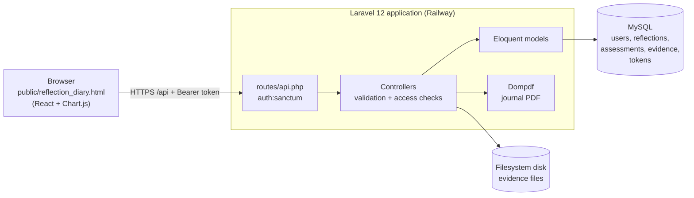
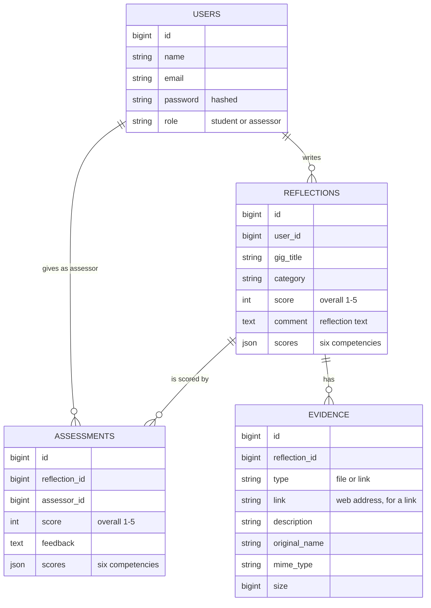
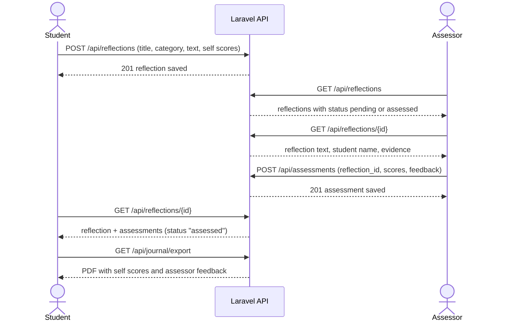

# Alumable Reflection Diary

A web application built as a capstone project for the sponsor **Alumable**. Students write structured reflections about their project work, attach evidence and rate themselves on six competencies. Assessors review the reflections and score the same competencies. Students then compare their own scores with the assessor's scores on a radar chart.

The diary is designed as a **student-owned, long-term record**. Each student's reflections, scores and assessor feedback are stored under their own account, so they can sign in from any browser at any time and find their record again, and they can export the whole journal as a PDF to keep.

Reflections are visible only to the student who wrote them and to assessors.

| Item | Details |
| --- | --- |
| **Live application** | https://cse3cap-production.up.railway.app/reflection_diary.html |
| **Source code** | https://github.com/Anh-B/CSE3CAP |
| **Backend** | Laravel 12 (PHP 8.2+), Laravel Sanctum, Eloquent ORM |
| **Frontend** | Web interface: a single page `public/reflection_diary.html` |
| **Database** | MySQL on Railway; SQLite for local use and tests |
| **Hosting** | Railway (the page and the API are served from the same domain) |
| **Automated tests** | PHPUnit, run on GitHub for PHP 8.2, 8.3 and 8.4 |

## Contents

1. [Project background and scope](#project-background-and-scope)
2. [Features](#features)
3. [How to use the application](#how-to-use-the-application)
4. [Architecture and design](#architecture-and-design)
5. [Design decisions and trade-offs](#design-decisions-and-trade-offs)
6. [Local installation](#local-installation)
7. [Configuration reference](#configuration-reference)
8. [Accounts, roles and access control](#accounts-roles-and-access-control)
9. [API overview](#api-overview)
10. [Testing and verification](#testing-and-verification)
11. [Deployment and operations](#deployment-and-operations)
12. [Maintenance and extension guide](#maintenance-and-extension-guide)
13. [Security notes](#security-notes)
14. [Dependencies and licences](#dependencies-and-licences)
15. [Troubleshooting](#troubleshooting)
16. [Known limitations](#known-limitations)
17. [Future development](#future-development)
18. [Lessons learned](#lessons-learned)
19. [Documentation and attribution](#documentation-and-attribution)

## Project background and scope
The original project plan assumed access to an Alumable-provided API and database. This access was not provided during the project, so integration with Alumable's systems could not be completed. The delivered build instead uses the Laravel API and the application database created for this project, independently of Alumable's production systems.

The application therefore demonstrates the reflection and assessment workflow as a standalone system. It does not claim access to, synchronisation with, or validation against Alumable's production data or identity system. Future integration would need client-approved API specifications, authentication arrangements, data mappings, test access and acceptance testing.

The project brief specified AWS hosting. Because no Alumable environment was available, the team deployed to Railway for the demonstration. The application is a standard Laravel app with MySQL and can be moved to AWS without code changes.

## Features
### Student
- Register and sign in. Public registration always creates a student account.
- Create, view, edit and delete reflections. Each reflection has a title, a category and free text. Reflections are stored on the server per account, so signing in from any browser shows the same entries.
- Rate themselves from 1 to 5 on six competencies and see the result on a radar chart: Contribution, Communication, Collaboration, Agile Improvement, Continuous Improvement, and Leadership & Initiative.
- Upload, download and remove evidence files on a reflection.
- Search, filter by category and sort the saved entries.
- See whether a reflection is still pending or has been assessed, and compare the assessor's scores with their own on the radar chart.
- Export their journal as reflection-journal.pdf. The PDF lists every reflection with the self-scores and an Assessor Feedback section (assessor name, scores and written feedback, or "Not assessed yet").

### Assessor
- A Pending Assessments tab lists reflections to review.
- Open a student's reflection and save scores for the six competencies.
- Read the student's name, the full reflection text and the evidence.
- Filter the list by Pending, Reviewed or All. The list refreshes after each score is saved.
- Add optional written feedback (up to 1000 characters) with the scores.
- Assessor accounts cannot be created from the Register tab (see [Accounts, roles and access control](#accounts-roles-and-access-control)).

## How to use the application
Open the application: [Alumable Reflection Diary](https://cse3cap-production.up.railway.app/reflection_diary.html "Ctrl-click (Cmd-click on Mac) to open").

### Student workflow

| Step | Where | What to do |
| --- | --- | --- |
| 1 | Browser | Choose **Need an account? Register**. Enter your name, an email and a password of at least 8 characters then click the **Register** button. On later visits, use **Log in** instead. |
| 2 | **01 New Entry** | Enter the Sprint / Gig title, category and reflection text. Attach evidence if needed. Choose **Save Reflection Entry**. Use **Save & Create New Entry** to save and start another form. |
| 3 | **Saved Reflection Entries** (below the form) | Search, filter or sort your saved reflection history. Choose **View / Edit** to reopen an entry, change it and choose **Update Reflection Entry**. Choose **Delete** to remove it. Choose a file chip to download evidence. |
| 4 | **02 Self-Assessment** | Rate your reflection from 1 to 5 for six competencies and choose **Save Scores**. |
| 5 | **03 Assessor Feedback** | Read-only for students. After the reflection is assessed, shows the assessor's written feedback (if any). The assessor's scores appear in the radar chart below. |
| 6 | **04 Progress Overview** | View a radar chart of your six competency scores. Once the reflection is assessed, the assessor's scores appear as a second line for comparison. |
| 7 | **Export Journal (PDF)** | Download all your reflections with scores and assessor feedback. |

Every sign-in starts with a blank radar chart. Choose **View / Edit** on a saved entry to load that entry's scores.

### Assessor workflow
| Step | Where | What to do |
| --- | --- | --- |
| 1 | Browser | Log in with an assessor account. Assessor accounts are created by the project team. |
| 2 | Pending Assessments | The list opens on **Pending**. Use **Pending**, **Reviewed** and **All** to filter it. Choose **Open to score** on a reflection. |
| 3 | **03 Assessor Feedback** | Read the **Reflection to assess** box: the student's name, the full reflection text and the evidence. Links open in a new tab and files download when chosen. |
| 4 | **03 Assessor Feedback** | Set the scores and optional written feedback and then choose **Save Assessor Scores**. Unlock **Supervisor Edit Mode** if it is locked. |
| 5 | Pending Assessments | The list refreshes automatically, and the reflection moves from **Pending** to **Reviewed**. Reviewed reflections can be reopened to change their scores. |
| 6 | **04 Progress Overview** | Check the radar chart for the open reflection. |

## Architecture and design

### System overview



After you sign in, the browser keeps a sign-in token so a page refresh does not log you out. The token is removed when you choose **Log out**. All reflections, scores and evidence are stored on the server, so signing in on another browser or device shows the same data. The page is a single file in `public/`, served by the same Laravel application as the API, so both use one domain and no cross-origin (CORS) setup is needed.

### Data model



Notes on the schema:

- Deleting a reflection also deletes its assessments and evidence. The model also removes the stored evidence files.
- `assessments.assessor_id` is a plain column, not a database foreign key, so an assessment keeps its assessor id even if that account is later removed.
- `scores` holds the six competency scores as JSON with the keys `contribution`, `communication`, `collaboration`, `agile`, `continuous` and `leadership`. The overall `score` is calculated by the interface from those six values.
- The assessment `feedback` column holds the assessor's optional written comment (up to 1000 characters).

### Scoring flow



The API also accepts `?status=pending` or `?status=assessed` on `GET /api/reflections` to filter the list. The interface loads the full list and filters it in the browser.

### Repository layout

| Location | Purpose |
| --- | --- |
| `public/reflection_diary.html` | The whole interface and its API client |
| `routes/api.php` | Authentication, reflection, assessment, evidence and export routes |
| `routes/web.php` | Root route; currently shows the Laravel welcome page |
| `app/Http/Controllers/` | Request handling, validation and access checks |
| `app/Models/` | `User`, `Reflection`, `Assessment`, `Evidence` |
| `app/Console/Commands/CreateAssessor.php` | `assessor:create` command |
| `database/migrations/` | Schema history |
| `database/seeders/DemoSeeder.php` | Optional demonstration data |
| `resources/views/journal/export.blade.php` | PDF layout |
| `config/cors.php` | Allowed frontend origins |
| `railway/init-app.sh` | Runs on every deploy: migrations and cache rebuild |
| `tests/` | Automated tests |
| `docs/` | API and deployment documentation |
| `.github/workflows/tests.yml` | Runs the tests on GitHub |

## Design decisions and trade-offs

| Decision | Reason | Alternatives considered | Trade-off |
| --- | --- | --- | --- |
| **Laravel 12 backend** | Mature framework with authentication, validation, migrations, testing and PDF support available out of the box. The team could build a secure API quickly. | A Node.js API; a backend-as-a-service | Needs PHP hosting. The team accepted this because Railway runs it with little setup. |
| **Laravel Sanctum bearer tokens** | Simple token sign-in that fits a page calling a JSON API. Tokens can be revoked. | Session cookies; JWT libraries | The token is stored in the browser, so it must be protected from cross-site scripting. |
| **One React page loaded from CDNs** | No build step, so any teammate can edit and deploy one file. | A bundled project (Vite and components) | The interface is one very large file and depends on CDN availability. Browser-side compilation makes first load slower. |
| **Page and API on the same domain** | No cross-origin requests, so no CORS configuration is needed, and one deploy updates both. | Frontend on Netlify, API on Railway | The frontend cannot be released separately from the backend. |
| **Reflections stored on the server, one record per entry** | The same account sees the same entries in any browser, and the assessor can read them. | Keeping entries in browser storage | Needs a network connection. Entries saved only in a browser before this change are not migrated. |
| **Assessor accounts created from the command line** | Prevents anyone from granting themselves the assessor role through the public sign-up page. | A role dropdown at sign-up; an admin screen | Creating an assessor needs someone with server access. |
| **Authorisation checked in the controllers** | Each action checks ownership or role next to the data it touches. | Laravel policies or gates | Checks are spread across controllers. Policies would centralise them (see [Future development](#future-development)). |
| **Evidence served only through an authenticated route** | Files are not publicly reachable by URL, and the stored path is hidden from API responses. | Public storage links | Downloads need the token, so the interface fetches the file and saves it itself. |
| **MySQL in production, SQLite locally and in tests** | A managed MySQL service is available on Railway, and SQLite needs no setup for development and tests. | MySQL everywhere | A small risk of differences between database engines. |

## Local installation
**Most readers do not need this section.** To use the application, open the [Alumable Reflection Diary](https://cse3cap-production.up.railway.app/reflection_diary.html) and follow [How to use the application](#how-to-use-the-application). **This section is for developers who want to run their own copy of the project on a local computer.**

### Prerequisites
- PHP 8.2 or newer, with the pdo_sqlite, mbstring, openssl, tokenizer, xml, ctype and fileinfo extensions enabled. Composer reports any missing extension during installation.
- Composer 2.
- Git, or an extracted copy of the repository.
- A modern browser with internet access.

The commands below work in a macOS or Linux shell and in Git Bash on Windows. In Windows PowerShell, replace cp with copy.
### Get the code and install dependencies
``` bash
git clone https://github.com/Anh-B/CSE3CAP.git
cd CSE3CAP
composer install
cp .env.example .env
php artisan key:generate
```

**Copy .env.example only for a new installation. For an existing installation keep your .env and application key.**

### Create the database
The example configuration uses SQLite. Create the file and apply the migrations:
``` bash
php -r "file_exists('database/database.sqlite') || touch('database/database.sqlite');"
php artisan migrate
```

### Point the page at your local API
The checked-in page calls the hosted API:
``` js
const API_BASE_URL = "https://cse3cap-production.up.railway.app/api";
```
To use your local server, change that line in public/reflection_diary.html to:
``` js
const API_BASE_URL = "/api";
```
Without this change, a locally opened page keeps sending requests to the hosted service and your local database stays empty. Do not commit this local change.

### Start the server and open the page
``` bash
php artisan serve --host=127.0.0.1 --port=8000
```
Open http://127.0.0.1:8000/reflection_diary.html. The root address / currently shows the Laravel welcome page, so always include /reflection_diary.html.

### Demonstration data (local only)
``` bash
php artisan db:seed --class=DemoSeeder
```

## Configuration reference

Settings live in the `.env` file locally and in the service's **Variables** on Railway.

| Variable | Local value | Production value | Purpose |
| --- | --- | --- | --- |
| `APP_KEY` | generated by `php artisan key:generate` | a fixed secret, never changed after launch | Encrypts sessions and data. Changing it signs everyone out. |
| `APP_ENV` | `local` | `production` | Environment name |
| `APP_DEBUG` | `true` | `false` | Detailed error pages. Must be `false` in production. |
| `APP_URL` | `http://127.0.0.1:8000` | the Railway domain | Base address |
| `DB_CONNECTION` | `sqlite` | `mysql` | Database driver |
| `DB_HOST`, `DB_PORT`, `DB_DATABASE`, `DB_USERNAME`, `DB_PASSWORD` | unset | Railway MySQL references | Database connection. See `docs/DEPLOYMENT.md` for the exact values. |
| `LOG_CHANNEL` | `stack` | `stderr` | On Railway, logs go to the deployment log because the disk is temporary. |
| `FILESYSTEM_DISK` | `local` | `local` | Where evidence files are stored. Local storage is lost on redeploy (see [Deployment and operations](#deployment-and-operations)). |
| `FRONTEND_URL` | unset | unset | The exact web address of a frontend hosted on a **different** domain. Not needed while the page is served by the same application. |

## Accounts, roles and access control
There are two roles, stored in `users.role`: `student` (the default) and `assessor`.

- Registration always creates a student.
- Sign-in returns a Sanctum bearer token. Every other route requires `Authorization: Bearer <token>`.
- Assessor accounts are created or upgraded with `php artisan assessor:create` (see [Create an assessor account](#create-an-assessor-account)).

### What each role can do

| Action | Student | Assessor |
| --- | --- | --- |
| Register | Yes | No |
| Log in | Yes | Yes |
| Create a reflection | Yes | Yes |
| List and read reflections | Own only | All |
| Edit or delete a reflection | Own only | Own only |
| Add or delete evidence | Own reflections only | Own reflections only |
| List or download evidence | Own reflections only | Yes |
| Submit an assessment | No | Yes |
| List or read assessments | Own reflections only | All |
| Export the PDF journal | Own reflections only | Own reflections only |

### Create an assessor account
Assessor accounts are created by the project team.
1. Register a normal account using the **Register** tab.
2. On Railway, open the service's **Console** tab and run:

    ``` bash
       php artisan assessor:create person@example.com --no-interaction
    ```

   With `--no-interaction`, an existing student account is upgraded to assessor without a prompt, which is what the Railway Console needs because it cannot answer prompts.
3. Sign out and log in again. The assessor features are now available.

To create a brand-new assessor from a normal terminal instead, run `php artisan assessor:create person@example.com "Full Name"`. The command asks for a password; the password never appears in the command history.

The name entered when the account is registered is the name shown as "Assessed by" in the PDF journal and in the pending list, so register assessors with their real name.

## API overview
Routes are defined in `routes/api.php`. Registration and log-in are public. Send `Accept: application/json` on every request. Full request and response examples are in [`docs/API.md`](docs/API.md).

| Method | Endpoint | Purpose |
| --- | --- | --- |
| POST | `/api/register` | Create a student account. Needs `name`, `email`, `password` (min. 8 characters). |
| POST | `/api/login` | Log in and receive a token |
| GET | `/api/user` | The signed-in user |
| POST | `/api/logout` | Revoke the token used for this request |
| GET, POST | `/api/reflections` | List reflections, or create one |
| GET, PUT, DELETE | `/api/reflections/{id}` | Read, update or delete a reflection |
| GET, POST | `/api/assessments` | List assessments (students see only those on their own reflections), or submit one (assessors only) |
| GET | `/api/assessments/{id}` | Read an assessment (students: own reflections only) |
| GET, POST | `/api/reflections/{id}/evidence` | List or add evidence (a file or a link) |
| GET | `/api/evidence/{id}/download` | Download an evidence file |
| DELETE | `/api/evidence/{id}` | Delete an evidence item |
| GET | `/api/journal/export` | Download the signed-in user's journal as a PDF |

Conventions:
- **Responses** carry `success` and, on error, `message`. Validation errors return `422` with an `errors` list. `/api/user` returns the user directly, and the export returns a PDF, so the response shape is not identical for every endpoint.
- **Reflection list** accepts `mine=1`, `status=pending` or `status=assessed`, `page`, and `per_page` (1 to 100, default 15). Each item includes `assessment_status` (`assessed` or `pending`).
- **Reflection fields:** `score` (1 to 5), `comment` (up to 5000 characters), `gig_title` (up to 255), `category` (up to 100) and `scores` (the six competencies, each 1 to 5).
- **Assessment fields:** `reflection_id`, `score` (1 to 5), `feedback` (up to 1000 characters, optional) and `scores`.
- **Evidence uploads**: the interface accepts PDF and text (`.txt`) files only. The API itself also accepts doc, docx, ppt, pptx, xls, xlsx, csv, png, jpg, jpeg, gif, webp and zip, up to 10 MB per file. Uploads use multipart form data. The PHP limit on the hosting (2 MB by default on Railway) applies as well.

## Testing and verification
### Automated test
``` bash
composer test
```
(or `php artisan test`). The tests use an in-memory SQLite database, so they never touch real data.

- **Result at the time of writing (13 October 2026):** 125 tests, 622 assertions, all passing.
- **Continuous integration:** `.github/workflows/tests.yml` runs the suite on GitHub for PHP 8.2, 8.3 and 8.4 on every pull request and push, and once a day.

| Test file | Tests | Covers |
| --- | --- | --- |
| `AuthApiTest.php` | 11 | Registration (student role only), sign-in, sign-out and token revocation, password rules |
| `ReflectionApiTest.php` | 56 | Create, list (scoping, paging, status filter), read, update, delete, validation, title and category, access rules, PDF view and export, assessor reading a reflection with its evidence. |
| `AssessmentApiTest.php` | 23 | Submit and read assessments, assessor-only rule, students reading only their own assessments, validation |
| `EvidenceApiTest.php` | 25 | Upload, allowed file types, download, delete, access rules |
| `CreateAssessorCommandTest.php` | 4 | Creating and upgrading assessor accounts |
| `ApiErrorFormatTest.php` | 3 | Consistent JSON error responses |
| `DemoSeederTest.php` | 1 | Demonstration data |
| `ExampleTest.php` (feature and unit) | 2 | Framework smoke tests |

### Requirements traceability

| Requirement | Verified by |
| --- | --- |
| Students and assessors sign in with separate roles | `AuthApiTest`, `CreateAssessorCommandTest` |
| Students save, edit and delete their own reflections | `ReflectionApiTest` |
| A student cannot read or change another student's reflections, evidence or assessments | `ReflectionApiTest`, `EvidenceApiTest`, `AssessmentApiTest` |
| An assessor can read a reflection's text, student name and evidence before scoring | `ReflectionApiTest`, `EvidenceApiTest` |
| Competency scores are validated from 1 to 5 | `ReflectionApiTest`, `AssessmentApiTest` |
| Only assessors submit assessments | `AssessmentApiTest` |
| Evidence upload, download and delete | `EvidenceApiTest` |
| PDF export contains the user's own entries, scores and assessor feedback | `ReflectionApiTest` (PDF tests) |
| A failed PDF export does not expose internal error details | `ReflectionApiTest` |

### Manual and browser verification

Automated backend tests do not prove that the browser interface works, so the team also checked it manually on the live application between 2 and 12 October 2026:

- A student registered, saved reflections, signed in from a second browser and saw the same entries, downloaded evidence, exported a PDF and deleted an entry.
- An assessor scored a student's reflection. The student then saw the **Assessed** status, the assessor's line on the radar chart, and the **Assessor Feedback** section in the exported PDF.

A scripted browser check against a local copy also confirmed that the same account sees the same entries in different browsers, that evidence downloads, that the PDF downloads, that a newly registered account sees no data from the previous account, that the Pending Assessments list updates after scoring, that the Pending and Reviewed filters work, that written feedback reaches the student, and that signing out revokes the token on the server.

### Checklist before a handover or release

1. Register, sign in and reload the page.
2. Save a reflection, sign in from a different browser and confirm it appears.
3. Upload and download an evidence file.
4. Submit assessor scores and written feedback, then view them from the student account.
5. Compare the radar chart with the saved scores.
6. Export a PDF that includes an assessed reflection.
7. Check that a student cannot read another student's reflections, evidence or assessments.
8. Record the date, environment, commit and result.

## Deployment and operations

The application runs on Railway and redeploys automatically whenever `main` changes on GitHub. The full setup procedure (project, MySQL service, variables, pre-deploy command and domain) is in [`docs/DEPLOYMENT.md`](docs/DEPLOYMENT.md).

- **Pre-deploy command:** `chmod +x ./railway/init-app.sh && sh ./railway/init-app.sh`. It runs `php artisan migrate --force`, clears caches and rebuilds the configuration, event and route caches on every deploy. New migrations therefore apply automatically.
- **Document root:** the web server must serve the `public/` directory.
- **Logs:** with `LOG_CHANNEL=stderr`, application errors appear in the deployment logs in Railway (**Deployments** tab, **View logs**).
- **Running commands:** use the service's **Console** tab, for example `php artisan assessor:create`.
- **Roll back:** if a deployment causes a problem, revert the change on GitHub (the **Revert** button on the merged pull request) and merge the revert pull request. Railway then deploys the previous code. The **Deployments** tab also offers **Redeploy** and **Restart** for the active deployment, and older deployments marked as removed may not be available. Database migrations are not undone automatically.
- **Backups:** back up the database and the evidence files before any change that touches stored data. The database alone is not a backup of uploaded evidence.
- **Evidence storage:** files are stored on the application's disk. Railway replaces that disk on every deploy, so **uploaded evidence is lost on redeploy** unless persistent storage is configured, such as a Railway volume or an S3-compatible disk (set `FILESYSTEM_DISK` accordingly). For the demonstration this is accepted; for real use it must be fixed.
- **Upload limits:** the application accepts up to 10 MB, but the default PHP limit on the hosting is 2 MB. Raise `upload_max_filesize` and `post_max_size` if larger files are needed.
- **Verifying a deployment:** an unauthenticated request returning `401` only shows that the authentication check responded. Verify a deployment by signing in, saving a reflection, uploading and downloading a file, and exporting a PDF.
- **Cost and availability:** the link works only while the Railway service is running. Check it before a demonstration, because the first request after a quiet period can occasionally be slow.

## Maintenance and extension guide

### Routine tasks

| Task | How |
| --- | --- |
| Deploy a change | Merge a pull request into `main`. Railway deploys it. |
| Add a database change | Run `php artisan make:migration <name>`, edit the file, add a test, and merge. The pre-deploy script applies it. |
| Create an assessor | `php artisan assessor:create <email> --no-interaction` (see [Create an assessor account](#create-an-assessor-account)) |
| Rename an assessor | The interface has no profile screen. Register the account with the real name before upgrading it to assessor (see [Create an assessor account](#create-an-assessor-account)). |
| Check logs | Railway **Deployments** tab, or `php artisan pail` locally |
| Run the tests | `composer test` |
| Check dependencies for known vulnerabilities | `composer audit --locked`. Run it before every release and record the result. See [Security notes](#security-notes) for the result on 13 October 2026. |
| Update dependencies | `composer update`, run the tests, check the application by hand, then merge. |
| Format code | `vendor/bin/pint` |

### Adding or changing a competency

The six competencies appear in four places that must change together:

1. `app/Http/Controllers/ReflectionController.php` (validation rules for `scores.*`, in both `store` and `update`).
2. `app/Http/Controllers/AssessmentController.php` (the same rules for assessor scores).
3. `public/reflection_diary.html` (the competency list, the default score objects and the radar chart labels).
4. `resources/views/journal/export.blade.php` (the lines printed in the PDF).

Add or update tests in `ReflectionApiTest.php` and `AssessmentApiTest.php` at the same time.

### Where to extend

| Goal | Where to start |
| --- | --- |
| New reflection field | A migration, the `$fillable` list in `Reflection`, validation in `ReflectionController`, the form in the HTML page, the PDF view |
| New role or rules | The `role` column, a Laravel policy or gate, and checks in the controllers |
| Notifications for students | A Laravel notification or mail sent from `AssessmentController::store` |
| Move evidence to cloud storage | Configure a disk in `config/filesystems.php` and set `FILESYSTEM_DISK` |
| Bundle the frontend | Move the page's script into the Vite build under `resources/js` |

## Security notes
Implemented:

- Passwords are hashed. Sign-in returns a revocable Sanctum token, and signing out revokes it on the server.
- The role is fixed to `student` at registration, so users cannot grant themselves assessor access.
- Reflections, evidence and assessments are checked for ownership on read, edit, delete and download. Assessors can read all.
- Evidence files are not served from a public URL. The stored path is hidden from API responses, and downloads need the token.
- Evidence uploads are checked by file content (MIME type) and by extension, with a size limit.
- Validation rules limit the length and range of all submitted values.
- `APP_DEBUG` is `false` in production, so internal error details are not shown to users. A failed PDF export logs the detail on the server and returns a generic message.

Points to be aware of:

- The sign-in token is kept in the browser's local storage so that a page refresh does not log the user out. It must therefore be protected from cross-site scripting.
- Demonstration accounts and their public passwords exist only when the demonstration seeder is run. Never run it on the live database.
- Open items are listed in [Known limitations](#known-limitations).

### Dependency audit (13 October 2026)

`composer audit --locked` reported 4 advisories in 3 packages. None is known to be exploitable in this application:

| Package (installed) | Severity | Issue | Exposure in this project |
| --- | --- | --- | --- |
| `laravel/framework` (12.66.0) | Low | XSS in the debug error page (fixed in 12.69.0) | `APP_DEBUG=false` in production, so the debug page is not shown |
| `league/commonmark` (2.10.0) | High | Denial of service in the table extension | The application does not render Markdown |
| `league/commonmark` (2.10.0) | Medium | Disallowed raw HTML filter bypass | The application does not render Markdown |
| `league/flysystem` (3.35.2) | Low | Control-character path check bypass | Evidence files are stored under names generated by the server |

These packages should be updated to patched releases (`composer update laravel/framework league/commonmark league/flysystem`), followed by the test suite and a manual check.

## Dependencies and licences
**Direct runtime dependencies** (versions from `composer.lock`)

| Package | Version | Purpose | Licence |
| --- | --- | --- | --- |
| `laravel/framework` | 12.66.0 | Application framework | MIT |
| `laravel/sanctum` | 4.3.3 | API token authentication | MIT |
| `barryvdh/laravel-dompdf` | 3.1.2 | PDF export wrapper | MIT |
| `dompdf/dompdf` (installed with the wrapper) | 3.1.6 | PDF engine | LGPL-2.1 |
| `laravel/tinker` | 2.11.1 | Interactive console | MIT |

**Development dependencies:** `phpunit/phpunit` 11.5.56, `mockery/mockery`, `fakerphp/faker`, `laravel/pint`, `laravel/pail`, `laravel/sail`, `nunomaduro/collision`.

**Browser libraries loaded from CDNs by the page:** React 18, ReactDOM, Babel (standalone), Tailwind CSS and Chart.js. These are not tracked by `composer.lock` or the Vite build, so a CDN outage or a change to a library's latest version can affect the page.

**Licence summary** (from `composer licenses`): most installed packages are MIT (83) or BSD-3-Clause (31). The PDF engine `dompdf` and two of its libraries are LGPL. Two Nette packages are offered under BSD-3-Clause, GPL-2.0 or GPL-3.0, and the permissive BSD-3-Clause option applies. Keep the licence notices of third-party packages when redistributing.

**Security of dependencies:** see the [dependency audit](#dependency-audit-13-october-2026) in Security notes.

**Project licence:** according to the project brief, intellectual property in the delivered solution is assigned to Alumable. No separate licence file has been added to the repository. The Composer manifest declares MIT, which is the default from the Laravel starter, so Alumable should confirm the licence it wants before one is added.

## Troubleshooting

| Symptom | Likely cause and fix |
| --- | --- |
| The page opens but sign-in or saving fails | The page was opened as a local file. Open it through the live link or through `php artisan serve`. |
| The Laravel welcome page appears | Open `/reflection_diary.html` after the domain. |
| A local page shows hosted data, or your local database stays empty | `API_BASE_URL` still points to Railway. Change it to `/api` (see [Local installation](#local-installation)). |
| Missing application key error | Run `php artisan key:generate`, then `php artisan config:clear`. |
| SQLite driver or "no such table" error | Enable `pdo_sqlite`, create `database/database.sqlite`, and run `php artisan migrate`. |
| Sign-in blocked by CORS | The page is on a different domain from the API. Set `FRONTEND_URL` on the backend to the exact origin of the page, with no trailing slash, and redeploy. |
| Upload rejected below 10 MB | The PHP or hosting limit (2 MB by default) is lower. Check `upload_max_filesize`, `post_max_size` and the allowed file types. |
| A file cannot be chosen for upload | The interface offers PDF and text (`.txt`) files only. |
| A new account cannot submit assessor feedback | Public registration creates students. Use `assessor:create`. |
| The assessor tabs do not appear after upgrading an account | Sign out and sign in again so the page reloads the role. |
| Demo seeding reports duplicate emails | The demo accounts already exist. Use them instead of seeding again. |
| A saved reflection or the radar chart looks empty after signing in | Entries load from the server. Choose **View / Edit** on a saved entry to load its scores. Entries that were saved only in a browser before the server-side change are not migrated. |
| Evidence files stopped downloading after a deployment | Railway replaced the disk. The files were lost (see [Deployment and operations](#deployment-and-operations)). |

## Known limitations
These are accurate for the current version. Items marked **fix recommended** should be corrected before the application holds real data.

| # | Limitation | Impact | Suggested fix |
| --- | --- | --- | --- |
| 1 | **Competencies are fixed in code.** The six competencies are written into the backend validation, the interface and the PDF. | Another framework (for example one chosen by a school or employer) needs a code change in four places. | Store competency sets in the database and let an assessor choose one (see [Adding or changing a competency](#adding-or-changing-a-competency)). |
| 2 | **No writing prompts or reminders.** The interface does not suggest what to write and does not remind students to reflect. | Students rely on their own routine. | Add prompts per category and an in-app or email reminder. |
| 3 | **No notification** when an assessor scores a reflection. | Students find out only when they open the entry. | Add email or in-app notifications. |
| 4 | **Assessors can write and score their own reflections (fix recommended).** Nothing prevents self-assessment by an assessor. | Weakens the independence of assessment. | Reject an assessment where the assessor owns the reflection. |
| 5 | **Save confirmation appears before the server answers** in the self-assessment and assessor-score handlers. | A failed save can look successful for a moment. Reloading shows the truth. | Show success only after the server confirms. |
| 6 | **Evidence is lost on redeploy**, and uploads above 2 MB fail on the default hosting. | Data loss and failed uploads | Persistent storage and higher PHP limits. |
| 7 | **Interface offers PDF and text evidence only**, although the API accepts more types and links. | Reduced capability | Extend the file input and add a link option. |
| 8 | **List size.** The student's own list loads up to 100 entries without paging, and the assessor's list loads up to 100 reflections. | Very large journals are cut off. | Paginate or load more on demand. |
| 9 | **Single large page with CDN dependencies.** The interface is one file with browser-side compilation, and the API address is written into it. | Slower first load, difficult to maintain, depends on CDN uptime. | Bundle the frontend and read the API address from configuration. |
| 10 | **Older browser-only entries are not migrated.** Entries stored only in a browser before reflections moved to the server are not uploaded. Any single reflection that existed on the server before that change appears as "Untitled reflection". | Old test data does not carry over. | Re-enter needed entries. |
| 11 | **No profile screen.** A user's name is set when the account is registered and cannot be changed in the interface. | An assessor registered with a generic name appears under that name in the PDF. | Add a profile screen. |
| 12 | **Each assessor save creates a new assessment record**, and the interface has no screen for the history of assessments. | Re-scoring keeps earlier records that are not shown in the interface. | Update the existing assessment instead, or show the history. |
| 13 | **Integration with Alumable is not possible yet.** No sandbox, API documentation or sample data was provided. | The application runs as a standalone system. | See [Project background and scope](#project-background-and-scope). |
| 14 | **No progress-over-time view.** The radar chart shows one reflection at a time; there is no combined or longitudinal view across sprints. | Students cannot see their overall growth in one place. | Add an aggregated chart (e.g. average per sprint) and a timeline view. |

## Future development
- Make the competency framework configurable, stored in the database instead of fixed in code, so that different frameworks can be used.
- Add writing prompts for each category and reminders for students (in the application or by email).
- Notify students when an assessor scores their reflection, and add an assessor dashboard with filters and search.
- Reject an assessment when the assessor owns the reflection, and add a profile screen so users can change their name.
- Introduce Laravel policies so access rules live in one place.
- Add persistent evidence storage and evidence links in the interface.
- Integrate with Alumable's systems once the sponsor provides API specifications, identity arrangements and test access.
- Bundle the frontend, split it into components and add browser-level tests.
- Add pagination to the entry list, and a student-facing view of the history of assessments.
- Update the dependencies reported by `composer audit` (see [Security notes](#security-notes)).
- Add a progress-over-time view that combines scores across sprints.
    
## Lessons learned

- **Verify a merge by its contents.** A pull request was merged that contained only a stray patch file instead of the intended code. Checking the **Files changed** tab before merging, and testing the deployed result afterwards, would have caught this immediately.
- **Careful review found security problems that tests alone did not.** Reading the code found a data leak (reflections and evidence readable by other users), a way for users to give themselves assessor access, and assessments readable by other students. All were fixed and now have automated tests.
- **Test the whole flow as each kind of user.** Manual testing as a student and as an assessor found problems that the automated tests had not: the exported PDF did not show the assessor's scores, the pending list needed a manual refresh after scoring, and there was no box for written feedback. Each was then fixed.
- **Data stored only in the browser is not a real feature.** Entries saved in browser storage disappeared in a different browser, which showed that "saved" has to mean saved on the server.
- **Define "done" to include integration.** A feature is done when the interface, the API and a test all work together, not when each part works alone.
- **Test integration early.** The interface and the API were joined late, in the final sprint, which concentrated risk. Testing them together sooner would have spread the work.

## Documentation and attribution
- [API documentation](docs/API.md): requests, responses and error formats.
- [Deployment documentation](docs/DEPLOYMENT.md): setting up Railway, variables and the pre-deploy command.
- This README also serves as the user guide (see [How to use the application](#how-to-use-the-application)) and as the maintenance guide (see [Maintenance and extension guide](#maintenance-and-extension-guide)).

**Project owner and sponsor:** Alumable. According to the project brief, intellectual property in the delivered solution is assigned to Alumable.

**Built with:** Laravel, Laravel Sanctum, Dompdf, React, Tailwind CSS and Chart.js. See [Dependencies and licences](#dependencies-and-licences).
