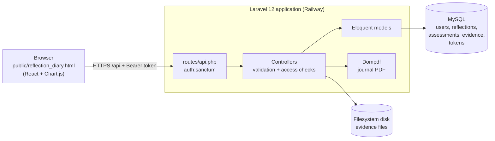
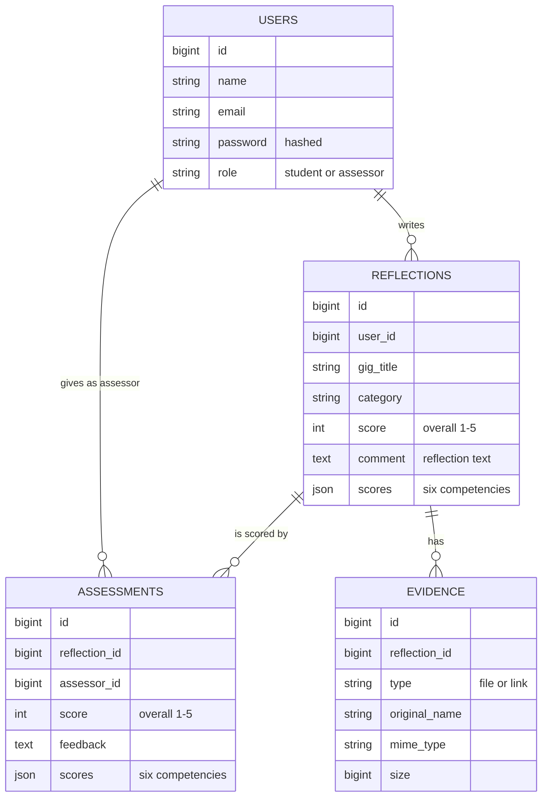
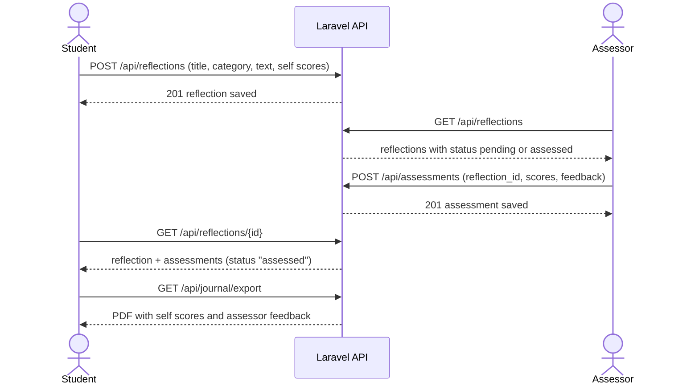

# Alumable Reflection Diary

A web application built as a capstone project for the sponsor **Alumable**. Students write structured reflections about their project work, attach evidence and rate themselves on six competencies. Assessors review the reflections and score the same competencies. Students then compare their own scores with the assessor's scores on a radar chart.

The diary is designed as a **student-owned, long-term record**. Each student's reflections, scores and assessor feedback are stored under their own account, so they can sign in from any browser at any time and find their record again, and they can export the whole journal as a PDF to keep.

Reflections are private to the student; only assessors can read them.

| Item | Details |
| --- | --- |
| **Live application** | https://cse3cap-production.up.railway.app/reflection_diary.html |
| **Source code** | https://github.com/Anh-B/CSE3CAP |
| **Backend** | Laravel 12 (PHP 8.2+), Laravel Sanctum, Eloquent ORM |
| **Frontend** | Web interface: a single page `public/reflection_diary.html` |
| **Database** | MySQL on Railway; SQLite for local use and tests |
| **Hosting** | Railway (the page and the API are served from the same domain) |
| **Automated tests** | 119 PHPUnit tests (606 assertions), run on GitHub for PHP 8.2, 8.3 and 8.4 |

## Contents

1. [Project background and scope](#project-background-and-scope)
2. [Features](#features)
3. [How to use the application](#how-to-use-the-application)
4. [Architecture and design](#architecture-and-design)
5. [Design decisions and trade-offs](#design-decisions-and-trade-offs)
6. [Local installation](#local-installation)
7. [Configuration reference](#configuration-reference)
8. [Accounts, roles and access control](#accounts-roles-and-access-control)
9. [API overview](#api-overview)
10. [Testing and verification](#testing-and-verification)
11. [Deployment and operations](#deployment-and-operations)
12. [Maintenance and extension guide](#maintenance-and-extension-guide)
13. [Security notes](#security-notes)
14. [Dependencies and licences](#dependencies-and-licences)
15. [Troubleshooting](#troubleshooting)
16. [Known limitations](#known-limitations)
17. [Future development](#future-development)
18. [Lessons learned](#lessons-learned)
19. [Documentation and attribution](#documentation-and-attribution)

## 1. Project background and scope
The original project plan assumed access to an Alumable-provided API and database. This access was not provided during the project, so integration with Alumable's systems could not be completed. The delivered build instead uses the Laravel API and the application database created for this project, independently of Alumable's production systems.

The application therefore demonstrates the reflection and assessment workflow as a standalone system. It does not claim access to, synchronisation with, or validation against Alumable's production data or identity system. Future integration would need client-approved API specifications, authentication arrangements, data mappings, test access and acceptance testing.

## 2. Features
### Students
- Register and sign in. Public registration always creates a student account.
- Create, view, edit and delete reflections. Each reflection has a title, a category and free text. Reflections are stored on the server per account, so signing in from any browser shows the same entries.
- Rate themselves from 1 to 5 on six competencies and see the result on a radar chart: Contribution, Communication, Collaboration, Agile Improvement, Continuous Improvement, and Leadership & Initiative.
- Upload, download and remove evidence files on a reflection.
- Search, filter by category and sort the saved entries.
- See whether a reflection is still pending or has been assessed, and compare the assessor's scores with their own on the radar chart.
- Export their journal as reflection-journal.pdf. The PDF lists every reflection with the self-scores and an Assessor Feedback section (assessor name, scores and written feedback, or "Not assessed yet").

### Assessor
- A Pending Assessments tab lists reflections to review.
- Open a student's reflection and save scores for the six competencies.
- Assessors can also read every student's reflections and evidence.
- Assessor accounts cannot be created from the Register tab (see [Accounts, roles and access control](#accounts-roles-and-access-control)).

## 3. How to use the application
Open the application: [Alumable Reflection Diary](https://cse3cap-production.up.railway.app/reflection_diary.html "Ctrl-click (Cmd-click on Mac) to open").

### Student workflow

| Step | Where | What to do |
| --- | --- | --- |
| 1 | Browser | Choose **Need an account? Register**. Enter your name, an email and a password then click the **Register** button. On later visits, use **Log in** instead. |
| 2 | **01 New Entry** | Enter the Sprint / Gig title, category and reflection text. Attach evidence if needed. Choose **Save Reflection Entry**. Use **Save & Create New Entry** to save and start another form. |
| 3 | **Saved Reflection Entries** (below the form) | Search, filter or sort your saved reflection history. Choose **View / Edit** to reopen an entry, change it and choose **Update Reflection Entry**. Choose **Delete** to remove it. Choose a file chip to download evidence. |
| 4 | **02 Self-Assessment** | Rate your reflection from 1 to 5 for six competencies and choose **Save Scores**. |
| 5 | **03 Assessor Feedback** | Read-only for students. Shows the assessor's scores and feedback (if any) after the reflection is assessed. |
| 6 | **04 Progress Overview** | View a radar chart of your six competency scores. Once the reflection is assessed, the assessor's scores appear as a second line for comparison. |
| 7 | **Export Journal (PDF)** | Download all your reflections with scores and assessor feedback. |

Every sign-in starts with a blank radar chart. Choose **View / Edit** on a saved entry to load that entry's scores.

### Assessor workflow
| Step | Where | What to do |
| --- | --- | --- |
| 1 | Browser | Log in with an assessor account.|
| 2 | Pending Assessments | Review the list. Choose **Open to score** on a reflection. Reflections show **Pending** until scored and **Reviewed** afterwards. After saving scores, choose **Refresh list** to update the statuses. Reviewed reflections can be reopened to change their scores. |
| 3 | **03 Assessor Feedback** | Set the scores and choose **Save Assessor Scores**. Unlock **Supervisor Edit Mode if it is locked. |
| 4 | **04 Progress Overview** | Check the radar chart. |

## Architecture and design

### System overview

After you sign in, the browser keeps a sign-in token so a page refresh does not log you out. The token is removed when you choose **Log out**. All reflections, scores and evidence are stored on the server, so signing in on another browser or device shows the same data. The page is a single file in `public/`, served by the same Laravel application as the API, so both use one domain and no cross-origin (CORS) setup is needed.

### Data model

Notes on the schema:

- Deleting a reflection also deletes its assessments and evidences. The model also removes the stored evidence files.
- `assessments.assessor_id` is a plain column, not a database foreign key, so an assessment keeps its assessor id even if that account is later removed.
- `scores` holds the six competency scores as JSON with the keys `contribution`, `communication`, `collaboration`, `agile`, `continuous` and `leadership`. The overall `score` is calculated by the interface from those six values.
- The assessment `feedback` column holds the assessor's optional written comment (up to 1000 characters).

### Scoring flow

The API also accepts `?status=pending` or `?status=assessed` on `GET /api/reflections` to filter the list. The interface loads the full list and filters it in the browser.

### Repository layout

| Location | Purpose |
| --- | --- |
| `public/reflection_diary.html` | The whole interface and its API client |
| `routes/api.php` | Authentication, reflection, assessment, evidence and export routes |
| `routes/web.php` | Root route; currently shows the Laravel welcome page |
| `app/Http/Controllers/` | Request handling, validation and access checks |
| `app/Models/` | `User`, `Reflection`, `Assessment`, `Evidence` |
| `app/Console/Commands/CreateAssessor.php` | `assessor:create` command |
| `database/migrations/` | Schema history |
| `database/seeders/DemoSeeder.php` | Optional demonstration data |
| `resources/views/journal/export.blade.php` | PDF layout |
| `config/cors.php` | Allowed frontend origins |
| `railway/init-app.sh` | Runs on every deploy: migrations and cache rebuild |
| `tests/` | Automated tests |
| `docs/` | API and deployment documentation |
| `.github/workflows/tests.yml` | Runs the tests on GitHub |

### Design decisions and trade-offs

| Decision | Reason | Alternatives considered | Trade-off |
| --- | --- | --- | --- |
| **Laravel 12 backend** | Mature framework with authentication, validation, migrations, testing and PDF support available out of the box. The team could build a secure API quickly. | A Node.js API; a backend-as-a-service | Needs PHP hosting. The team accepted this because Railway runs it with little setup. |
| **Laravel Sanctum bearer tokens** | Simple token sign-in that fits a page calling a JSON API. Tokens can be revoked. | Session cookies; JWT libraries | The token is stored in the browser, so it must be protected from cross-site scripting. |
| **One React page loaded from CDNs** | No build step, so any teammate can edit and deploy one file. | A bundled project (Vite and components) | The interface is one very large file and depends on CDN availability. Browser-side compilation makes first load slower. |
| **Page and API on the same domain** | No cross-origin requests, so no CORS configuration is needed, and one deploy updates both. | Frontend on Netlify, API on Railway | The frontend cannot be released separately from the backend. |
| **Reflections stored on the server, one record per entry** | The same account sees the same entries in any browser, and the assessor can read them. | Keeping entries in browser storage | Needs a network connection. Entries saved only in a browser before this change are not migrated. |
| **Assessor accounts created from the command line** | Prevents anyone from granting themselves the assessor role through the public sign-up page. | A role dropdown at sign-up; an admin screen | Creating an assessor needs someone with server access. |
| **Authorisation checked in the controllers** | Each action checks ownership or role next to the data it touches. | Laravel policies or gates | Checks are spread across controllers. Policies would centralise them (see [Future development](#future-development)). |
| **Evidence served only through an authenticated route** | Files are not publicly reachable by URL, and the stored path is hidden from API responses. | Public storage links | Downloads need the token, so the interface fetches the file and saves it itself. |
| **MySQL in production, SQLite locally and in tests** | A managed MySQL service is available on Railway, and SQLite needs no setup for development and tests. | MySQL everywhere | A small risk of differences between database engines. |

## 6. Local installation
